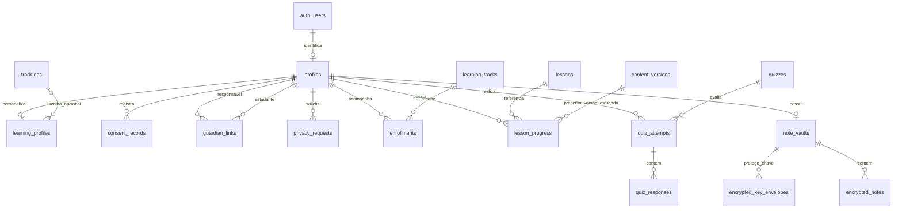
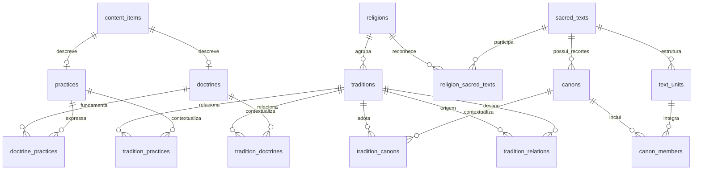
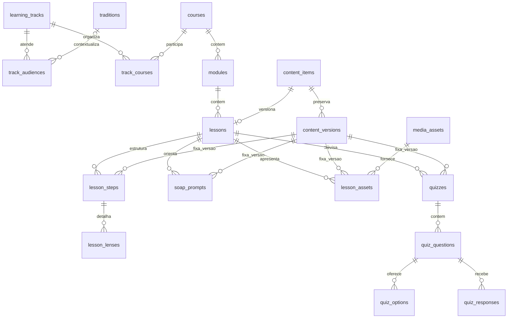
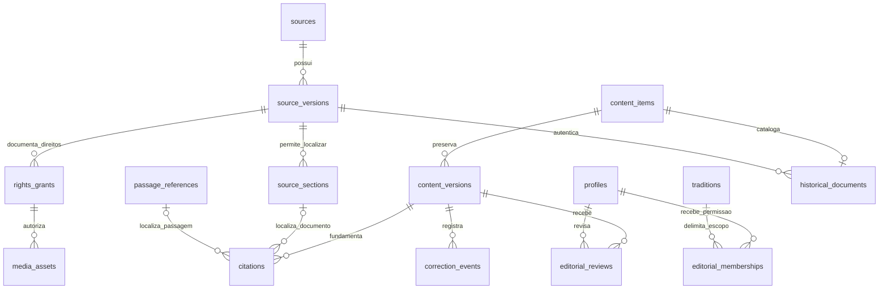
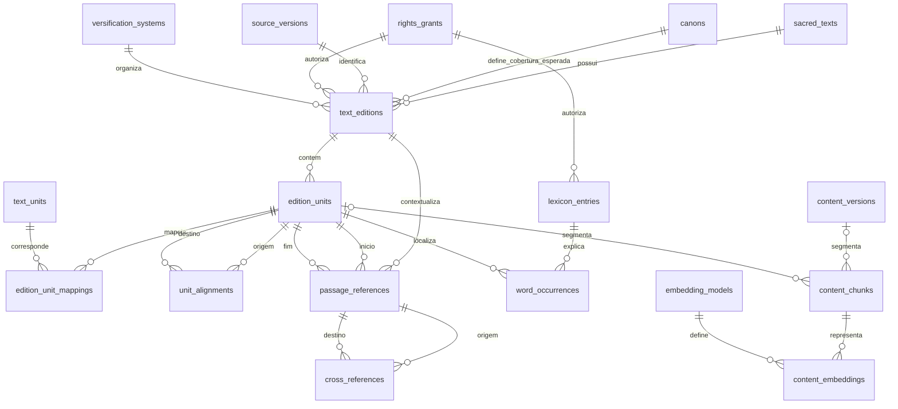

# InJessusName — proposta de arquitetura da Etapa 1

Data: 21 de outubro de 2026. Estado: **desenho de referência, com fundação implementada após confirmação do autor; validações e limites atuais no README**.

Este documento organiza a arquitetura mestre fornecida pelo autor do projeto. A primeira entrega solicitada é o diagrama do Supabase; a geração do projeto Next.js e do SQL vem após sua confirmação. O repositório estava vazio na inspeção inicial.

Após a confirmação, foram criados o projeto Next.js e as migrações SQL. Privilégios editoriais, gabaritos e o estado mínimo de proteção de menores conhecidos ficam em tabelas do esquema `private`. A persistência de ciphertext está preparada; o cliente E2EE ainda não foi implementado. O desenho abaixo conserva o escopo completo acordado, inclusive recursos das próximas etapas.

## 1. Compromissos do projeto

- Fase 1 exclusivamente cristã: núcleo bíblico comum e trilhas CCB, católica e evangélica/protestante, respeitando suas diferenças e identificando a perspectiva de cada conteúdo.
- Pré-entrevista acolhedora antes do catálogo: faixa etária, vínculo eclesiástico, batismo autodeclarado e objetivo. O percurso é ajustável pelo estudante.
- Quatro experiências etárias: 6–9, 10–12, 13–17 e 18+. A trilha de 10–12 anos terá abordagem investigativa própria.
- Aulas com estimativa de 15–20 minutos: preparação; contexto visual; exegese com seis lentes; reflexão S.O.A.P., resumo e revisão.
- Estudo apoiado na Bíblia física, no contexto das passagens e em fontes identificáveis. Distinguir texto, interpretação, doutrina de uma tradição e documento histórico.
- A plataforma é educacional e independente. Conclusão de módulos não confere cargo, ordenação ou reconhecimento institucional.
- O nome da formação CCB será “Guia de Zelo Doutrinário, Bom Testemunho e Conhecimento dos Santos Serviços”.
- Conteúdo sobre outras religiões não será exibido na Fase 1. A matriz permitirá acrescentar tradições e textos como dados; funcionalidades futuras ainda poderão exigir migrações adicionais.

## 2. Distribuição de responsabilidades

| Tecnologia | Responsabilidade | Limite |
| --- | --- | --- |
| Next.js, React, TypeScript e Tailwind | Interface, rotas, adaptação por perfil e PWA | A interface não substitui políticas de acesso no servidor. |
| Supabase Auth e PostgreSQL | Identidade, pré-entrevista, currículo, acervo, léxico, referências, progresso e conteúdo cifrado do caderno | Dados pessoais protegidos por propriedade, grants e RLS. |
| pgvector | Busca em conteúdo autorizado e editorialmente publicado | Sem notas pessoais ou inferências sobre crença nos índices compartilhados. |
| Firebase | FCM, presença e interações em tempo real na Etapa 5 | Não armazenar a Bíblia no Firestore; regras próprias e integração explícita de identidade. |
| Neo4j | Projeção de relações entre personagens, lugares, eventos e fontes na Etapa 3 | Sem perfis e notas privadas; licenças dos datasets verificadas antes da carga. |
| Upstash Redis e CDN | Cache e entrega de edições autorizadas | Cache não é fonte de verdade; respeitar edição, versão, direitos, expiração e invalidação. |
| IndexedDB e service worker | Conteúdo disponível offline no dispositivo | Download condicionado à licença; não manter cópias privadas legíveis em cache público. |

“Custo zero” não é uma garantia: franquias, tráfego, armazenamento, licenças e operações precisarão de orçamento e acompanhamento. Na Etapa 1, Firebase, Neo4j e Redis são fronteiras arquiteturais; sua integração funcional permanece nas etapas previstas pelo autor.

## 3. Diagrama A — identidade, aprendizado e privacidade

`auth_users` representa a tabela `auth.users` administrada pelo Supabase. As demais entidades são tabelas propostas da aplicação. Uma ligação representa uma chave estrangeira; tabelas de associação explicitam as relações muitos para muitos.

| Tabela | Campos e regras principais |
| --- | --- |
| `profiles` | `user_id` PK/FK para Auth, nome de exibição opcional, idioma e preferências de acessibilidade. Sem denominação no perfil público. |
| `learning_profiles` | `user_id` PK/FK, faixa etária, `tradition_id` anulável, batismo autodeclarado, objetivo, versão da entrevista e data da atualização. Não exigir data de nascimento completa sem necessidade. Permitir não informar dados sensíveis. |
| `consent_records` | Usuário, finalidade, versão do aviso, concessão/revogação e evidência mínima. Registro auditável; retirada de consentimento precisa ter efeito no processamento. A base legal de cada finalidade será definida separadamente. |
| `guardian_links` | Responsável, estudante, tipo e estado da verificação, vigência e revogação. Identidades associadas e aprovação não são editáveis unilateralmente pelo solicitante. Vínculo não concede leitura automática do caderno privado. |
| `privacy_requests` | Titular, tipo de solicitação, estado e datas de atendimento. Exportação e exclusão devem abranger serviços integrados. |
| `enrollments` | Usuário e trilha, com combinação única e estado de acompanhamento. |
| `lesson_progress` | Combinação única de usuário, aula e `content_version_id`; progresso e conclusão daquela versão. Validar que a versão pertence à aula; preservar versões estudadas anteriormente. Não funciona como certificado de aptidão religiosa. |
| `quiz_attempts`, `quiz_responses` | Tentativas e respostas próprias. Questões devem pertencer ao quiz indicado; cálculo de pontuação confiável no servidor. |
| `note_vaults` | Cofre do usuário e versão do protocolo criptográfico. Não armazena chave de decifragem em claro. |
| `encrypted_key_envelopes` | Chaves do cofre envelopadas para dispositivo ou recuperação, com identificadores e parâmetros necessários ao protocolo escolhido. |
| `encrypted_notes` | Cofre, identificador, ciphertext, nonce, versão da chave, versão de sincronização e timestamps mínimos. Título, corpo, campos S.O.A.P., referências e categoria culto/estudo ficam no conteúdo cifrado. |

O status de batismo adapta sugestões e sequências de estudo. Não será usado como classificação de valor pessoal nem como autorização de acesso a documentos institucionais restritos.

## 4. Diagrama B — matriz religiosa, doutrinas e cânones

A matriz é uma rede de relações, não uma sequência rígida de cinco tabelas. Uma prática pode relacionar-se a várias doutrinas; textos podem ser compartilhados por tradições com cânones e interpretações diferentes.

| Tabela | Campos e regras principais |
| --- | --- |
| `religions` | Identidade, código estável e estado de publicação. Apenas Cristianismo publicado na Fase 1. |
| `traditions` | Religião, identidade e descrição. A CCB pode ter identidade própria sem impor uma classificação histórica controversa como fato. |
| `tradition_relations` | Origem, destino, natureza da relação e `evidence_version_id` FK para `content_versions`, com citações que sustentem a afirmação. Impedir autorreferência; relações hierárquicas não podem formar ciclos. |
| `doctrines`, `practices` | Identidade estável vinculada a conteúdo versionado. Sem presumir que uma descrição representa todas as tradições. |
| `tradition_doctrines`, `tradition_practices` | Tradição, doutrina/prática, qualificação, vigência e `evidence_version_id` FK para uma versão editorial com as citações da associação. |
| `doctrine_practices` | Associação entre doutrina e prática e `evidence_version_id` FK para a versão que a documenta. |
| `sacred_texts`, `religion_sacred_texts` | Corpus e suas associações religiosas. Corpus não é tradução nem arquivo de versículos. |
| `canons`, `tradition_canons`, `canon_members` | Nome do cânone, adoção por tradição, membros e ordem. `evidence_version_id` FK para `content_versions` documenta a definição e as associações. Não fixar 66 ou 73 livros em lógica global. |
| `text_units` | Corpus, unidade-pai, tipo de unidade e código estável. Na Bíblia, livros, capítulos e versículos; outros corpora podem ter outras divisões. |

As associações com cânones, doutrinas e práticas precisam de fonte e revisão, assim como o próprio conteúdo. As chaves estrangeiras e validações devem impedir mistura acidental entre religiões, corpora e unidades incompatíveis.

## 5. Diagrama C — currículo e Método Bereano Híbrido

| Tabela | Campos e regras principais |
| --- | --- |
| `learning_tracks` | Núcleo comum, trilha CCB, católica e trilhas protestantes identificadas. Perspectiva e objetivo explícitos. |
| `track_audiences` | Trilha, faixa etária, tradição opcional, batismo e objetivo; critérios opcionais e prioridade definida. Não duplicar toda a aula para cada combinação. |
| `courses`, `track_courses` | Curso, associação com trilhas e ordem. Um curso comum pode participar de várias trilhas. |
| `modules`, `lessons` | Ordem, objetivos pedagógicos, pré-requisitos e estimativa de duração. Aula aponta para sua identidade editorial. |
| `lesson_steps` | `lesson_id`, `content_version_id`, quatro tipos e ordem única por versão: preparação, contexto visual, exegese e reflexão/revisão. Validar que a versão pertence à identidade editorial da aula. |
| `lesson_lenses` | Seis tipos: literária, espacial, histórica, cultural, bíblica e prática. Fonte e contexto vinculados à versão de conteúdo correspondente. |
| `soap_prompts` | `lesson_id`, `content_version_id` e três perguntas ordenadas que, em conjunto, orientam Escritura, Observação, Aplicação e Oração. |
| `media_assets`, `lesson_assets` | Imagem, vídeo, áudio, mapa ou PDF; autoria, fonte, direitos, idioma, acessibilidade e modo autorizado de exibição. A associação com a aula contém `lesson_id` e `content_version_id`. |
| `quizzes`, `quiz_questions`, `quiz_options` | Cada quiz contém `lesson_id` e `content_version_id`; perguntas, alternativas e justificativas pertencem ao quiz daquela versão. Tentativas preservam esse vínculo. Gabaritos não devem ser enviados antes da correção quando isso comprometer a avaliação. |

Uma aula só pode ser publicada como completa depois de validar os quatro passos, as seis lentes, as referências, as perguntas S.O.A.P., a revisão e a adequação etária. Rascunhos podem estar incompletos. A publicação é uma operação transacional validada no banco/servidor, não apenas um botão na interface. Passos, lentes, perguntas, associações multimídia e quizzes publicados ficam imutáveis; alterações criam outra versão. Chaves compostas ou validações equivalentes impedem combinar a identidade de uma aula com a versão de outra.

O aviso da Bíblia física e do caderno aparece antes do início. O contexto visual terá duração aproximada de 3 minutos; a exegese, 7; a reflexão, 5. Essas estimativas não obrigam o estudante a avançar sem compreender.

## 6. Diagrama D — fontes, acervo e revisão editorial

| Tabela | Campos e regras principais |
| --- | --- |
| `sources` | Instituição/autoria, título, URL primária e tipo de fonte. |
| `source_versions` | Edição/número, publicação, consulta, vigência, versão anterior, estado de autenticação e hash do exemplar quando sua retenção for autorizada. |
| `source_sections` | Página, artigo, tópico, parágrafo ou localizador estável. O conteúdo integral só será armazenado quando autorizado. |
| `rights_grants` | Titular, evidência da licença/autorização, atribuição, território, finalidade, prazo e permissões independentes de reprodução, cache, offline, redistribuição, uso comercial e processamento por IA. Desconhecido não significa permitido. |
| `content_items`, `content_versions` | Identidade estável e versões editoriais imutáveis. Tipo, título, perspectiva, texto autorizado/autoral, estado editorial, classificação de acesso e contexto temporal. |
| `citations` | Versão editorial e alvo verificável: uma passagem ou uma seção documental. Exigir exatamente um tipo de alvo por registro. |
| `historical_documents` | Catálogo de artigos, circulares, ensinamentos e documentos históricos; instituição, número, tipo, fonte exata e identidade editorial. |
| `editorial_reviews` | Versão examinada, revisor, escopo de competência, decisão e justificativa. Separar revisão histórica, confessional, pedagógica e de direitos. |
| `editorial_memberships` | Privilégios editoriais concedidos por processo administrativo, com escopo e validade. Não editáveis pelo titular do perfil. |
| `correction_events` | Motivo, versão afetada, correção/substituição e responsável. Preservar rastreabilidade, sem continuar exibindo conteúdo corrigido como atual. |

O catálogo distinguirá fonte histórica, orientação em vigor e interpretação pedagógica. Um documento antigo não se torna norma atual por estar no banco. Uma cópia pública na internet não torna um documento interno livre para republicação.

Os 12 artigos da CCB, a Circular nº 222/2025, a RGE 2025 e as regras específicas relatadas no documento do autor **ainda não foram autenticados nesta pesquisa**. Não serão transcritos nem apresentados como normas oficiais verificadas a partir de paráfrases. A trilha poderá catalogar pendências bibliográficas, mas não publicá-las como ensino confirmado.

O aviso de independência institucional ficará visível. Nenhum percurso prometerá habilitação ministerial. Orientações confessionais históricas não serão convertidas pelo aplicativo em instruções para abandonar medicamentos ou atendimento profissional.

## 7. Diagrama E — edições, referências, léxico e busca

| Tabela | Campos e regras principais |
| --- | --- |
| `text_editions` | Corpus, idioma, edição exata, provedor, fonte, autorização, `canon_id` e sistema de versificação. O cânone indica a cobertura esperada; os segmentos disponíveis registram a cobertura real, inclusive em edições parciais. Texto e edição crítica são produtos distintos. |
| `versification_systems` | Identidade e documentação do sistema de numeração. |
| `edition_units` | Edição, localizador nativo, ordem e conteúdo quando autorizado. Pode representar segmentos divididos/agrupados; não presumir correspondência universal 1:1. |
| `edition_unit_mappings` | Associação N:N entre segmentos de uma edição e unidades do corpus, com tipo de correspondência e evidência. Um segmento pode abranger vários versículos e um versículo pode estar dividido em segmentos. Validar compatibilidade do corpus. |
| `unit_alignments` | Alinhamento documentado entre unidades de edições; agrupamentos permitem relações N:N. Não é tradução automática nem prova de equivalência semântica. |
| `passage_references` | Edição e intervalo identificável. Início e fim devem pertencer à edição indicada e respeitar a ordem. |
| `cross_references` | Passagem de origem/destino, natureza da relação, fonte e direitos. Quantidade real será medida após importação autorizada; não anunciar 30 mil referências inexistentes. |
| `lexicon_entries` | Idioma, lema, identificador Strong quando aplicável, morfologia, glossas, origem e direitos próprios. O número Strong não licencia qualquer dicionário. |
| `word_occurrences` | Edição/unidade, posição do token, forma original, lema e análise. Transliteração para português deve indicar método e revisão. |
| `embedding_models` | Modelo, provedor, versão, dimensão e configuração de geração. |
| `content_chunks` | Trecho de versão editorial ou unidade textual; exigir exatamente um alvo e conservar fonte/licença. |
| `content_embeddings` | Chunk, modelo, hash do conteúdo e vetor. Índices separados por dimensão/modelo compatível; extensão `vector` preparada no SQL. |

As buscas respeitarão estado editorial, tradição solicitada, classificação de acesso e direitos. Não usar `SECURITY DEFINER` irrestrito para contornar RLS na busca. Troca de modelo ou conteúdo exige regeneração rastreável dos vetores afetados. Embeddings também dependem de autorização de processamento e de avaliação do provedor.

Hebraico deve preservar sinais massoréticos e direção RTL; remoção de pontuação ou normalização que altere a sequência original não será aplicada à exibição. A interface terá tamanho de fonte independente e transliteração revisada. A forma original e os dados linguísticos terão direitos registrados separadamente.

## 8. Segurança e privacidade que o futuro SQL precisa garantir

1. RLS em todas as tabelas expostas pela API, acompanhada de grants mínimos. Tabelas pessoais terão políticas separadas de leitura, criação, atualização e exclusão, permitindo somente as operações apropriadas; atualizações validam tanto a linha existente quanto a nova propriedade. Evidências de consentimento são auditáveis: concessão e revogação não autorizam reescrever o histórico.
2. Isolamento também nas tabelas filhas e nos relacionamentos: um usuário não pode vincular uma resposta, nota ou progresso a registros privados de outro usuário.
3. Conteúdo editorial exposto ao público somente quando publicado, autorizado e destinado àquela audiência. Documentos internos não serão abertos por escolha de denominação.
4. Privilégios editoriais e administrativos ficam fora de campos editáveis pelo próprio usuário. Chaves administrativas/secretas nunca entram no navegador; elas podem ignorar RLS.
5. Views, funções, arquivos no Storage e integrações recebem a mesma avaliação de acesso. RLS no PostgreSQL não protege automaticamente Firebase, Neo4j, Redis ou logs.
6. Crença religiosa, batismo e dados que os revelem exigem minimização e finalidade explícita. Não colocá-los em URLs, analytics, notificações visíveis ou caches compartilhados.
7. A experiência de menores precisa de desenho específico, verificação adequada e avaliação do melhor interesse. Não coletar perfil religioso de criança antes de existir um fluxo de proteção apropriado. Um checkbox isolado não resolve esse requisito. Ninguém pode aprovar o próprio vínculo de responsável, trocar unilateralmente o estudante vinculado ou atribuir `verified` a si; verificação e alterações administrativas exigem operação controlada e auditada.
8. Exclusão, exportação, retenção, revogação e sincronização offline serão fluxos reais. Cópias em dispositivos desconectados não podem ser prometidas como apagadas instantaneamente.
9. RLS e criptografia são controles técnicos; não garantem, isoladamente, conformidade integral com a LGPD. A definição jurídica e operacional será documentada antes de produção.

### Caderno com criptografia ponta a ponta

- Cifrar e decifrar no dispositivo com protocolo autenticado e biblioteca revisada, sem criptografia inventada. A Etapa 1 prepara a persistência; o recurso só poderá ser anunciado como E2EE depois da implementação e validação do cliente.
- O servidor mantém ciphertext e chaves envelopadas, não a chave capaz de abrir as notas em claro. Metadados operacionais restantes ainda precisam de proteção e retenção mínima.
- A escolha de recuperação, rotação de chaves, novos dispositivos e conflitos offline antecede o lançamento do caderno. Redefinir a senha da conta não implica recuperar uma chave perdida.
- Filtros culto/estudo e pesquisa nas notas são feitos no cliente após decifragem. Isso permite manter categoria, título e referências dentro do payload cifrado.
- O tutor e o índice vetorial não acessam o caderno por padrão. Um eventual envio de trecho à IA será uma ação explícita do estudante, com indicação do que será compartilhado.
- E2EE não protege de um dispositivo comprometido ou de código malicioso executado na sessão; segurança do frontend e controle de dependências continuam necessários.

## 9. Limites das etapas seguintes preservados no desenho

- **Etapa 2:** pré-entrevista conversacional, persistência com controles de privacidade e roteamento adaptativo. Acesso visitante sem pressão para declarar vínculo religioso.
- **Etapa 3:** leitor multiversão, gaveta, seis lentes, léxico, mapas e medidas. Conversões antigas terão unidade, época/região, fonte e faixa de aproximação; evitar falsa precisão.
- **Etapa 4:** aulas e módulos iniciais com curadoria, revisões e conteúdo autorizado; não gerar um acervo de normas a partir de memória ou texto não autenticado.
- **Etapa 5:** oração, pausa, presença, perguntas moderadas e tutor com recuperação de fontes. Sem credenciais de provedor ou corpus aprovado, não simular uma IA como integração real.
- O memorial de oração pessoal será privado e cifrado, preferencialmente no cofre Supabase. O Firebase cuidará de interações em tempo real e versões explicitamente compartilhadas; não duplicar pedidos íntimos em coleções públicas.
- “Pergunta anônima” precisa distinguir anonimato para outros participantes de anonimato perante operadores e fornecedores. Texto livre, logs e metadados podem identificar alguém; moderação é necessária antes da publicação.
- O tutor citará passagens e seções realmente recuperadas e autorizadas, indicando a tradição da resposta. Na ausência de fundamento suficiente, informará a limitação. Não inventará versículos, documentos, páginas ou números de circulares.
- BibleProject, música, imagens, filmes, PDFs e QR codes não dispensam direitos autorais. Incorporação, download, adaptação e redistribuição são permissões diferentes.
- Uma sessão Supabase não autoriza automaticamente o Firebase. A Etapa 5 precisará de vínculo de identidade e Security Rules testadas.

## 10. Pesquisa de fontes realizada

Fontes oficiais de projetos consultadas com sucesso em 21/10/2026:

| Fonte | Resultado e efeito no projeto |
| --- | --- |
| [fetch(bible): termos](https://github.com/gracious-tech/fetch/blob/10eb611ff496fad837fc8a61147360a302b7816e/site/src/legal/terms/index.md) | Licença MIT-0 do código não substitui licença de cada tradução. Verificar direitos por edição antes de armazenar ou distribuir. |
| [fetch(bible): conteúdo](https://github.com/gracious-tech/fetch/blob/10eb611ff496fad837fc8a61147360a302b7816e/site/src/content/index.md) | A coleção oficial documentada cobre 66 livros, sem deuterocanônicos e adições católicas. Precisaremos de outra fonte autorizada para cumprir os 73 livros da trilha católica. |
| [fetch(bible): acesso](https://github.com/gracious-tech/fetch/blob/10eb611ff496fad837fc8a61147360a302b7816e/site/src/access/index.md) | Distribuição padronizada na versificação KJV e limitações documentadas em material baseado na LXX. Isso justifica alinhar edições explicitamente. |
| [Cliente oficial no npm](https://registry.npmjs.org/@gracious.tech%2ffetch-client/latest) | Pacote `@gracious.tech/fetch-client`, versão consultada 2.5.0. A seleção e o pin da versão ocorrerão na implementação. |
| [OpenScriptures: README](https://github.com/openscriptures/morphhb/blob/3d15126fb1ef74867fc1434be1942e837932691f/README.md) e [licença](https://github.com/openscriptures/morphhb/blob/3d15126fb1ef74867fc1434be1942e837932691f/LICENSE.md) | O projeto distingue texto WLC em domínio público de lemas/morfologia CC BY 4.0, com atribuição. Isso não licencia indistintamente a edição crítica BHS. |
| [thiagobodruk/bible: origem](https://github.com/thiagobodruk/bible/blob/master/README.md) e [licença do repositório](https://github.com/thiagobodruk/bible/blob/master/LICENSE) | Um arquivo disponível num repositório com licença MIT não comprova cessão dos direitos de cada tradução incluída. Não importar ACF ou traduções modernas com essa suposição. |
| [Supabase: fonte oficial da documentação de RLS](https://github.com/supabase/supabase/blob/master/apps/docs/content/guides/database/postgres/row-level-security.mdx) | Confirma grants mínimos, RLS por operação, cuidados com views/funções e chaves que podem ignorar RLS. |

**Pendências específicas:** a procedência e os direitos de um arquivo ARC 1911, os termos da ACF, NA28/BHS, as condições atuais de YouVersion/Bible Brain, as licenças de cada recurso multimídia e a autenticidade/uso autorizado dos documentos CCB. Nenhum desses materiais foi importado. A edição de um texto histórico precisa ser identificada; o ano no nome de um arquivo não basta para provar sua origem.

Alguns sites de titulares e instituições não puderam ser lidos porque o proxy retornou `403 Forbidden` na abertura da conexão HTTPS. Isso não significa que os sites estejam fora do ar. Não foi possível confirmar diretamente fontes em CCB, Vaticano, editoras bíblicas, Planalto e no domínio web do Supabase. A documentação de projetos acessível em seus repositórios oficiais foi usada quando disponível.

Domínios a permitir nas configurações de rede para aprofundar essa verificação, preservando as regras já existentes: `congregacaocristanobrasil.org.br`, `www.congregacaocristanobrasil.org.br`, `www.vatican.va`, `fetch.bible`, `biblias.com.br`, `www.biblias.com.br`, `die-bibel.de`, `www.die-bibel.de`, `sbb.org.br`, `www.sbb.org.br`, `www.planalto.gov.br` e `supabase.com`. São destinos de pesquisa, não uma lista completa dos futuros serviços de runtime. Esta proposta de arquitetura não altera a política de rede.

O domínio/API `abibliadigital.com.br` não foi acessado e não será usado pelo projeto, conforme a instrução do autor. A afirmação sobre a data de encerramento não foi usada como fato histórico verificado.

## 11. Entrega seguinte, após confirmação do autor

1. Inicializar Next.js com App Router, TypeScript e Tailwind, versões fixadas e lockfile; incluir base PWA, sem anunciar offline completo antes de implementá-lo.
2. Criar migrações Supabase versionadas para as entidades e restrições acordadas, extensão `vector`, índices e políticas RLS. Separar esquemas expostos de funções/rotinas administrativas privadas.
3. Criar apenas dados iniciais cadastrais e conteúdo autoral revisável; não importar corpora ou doutrinas integrais sem liberação documental.
4. Validar as migrações em instância local ou projeto Supabase autorizado. Não executar SQL em produção sem destino explícito e revisão.
5. Testar isolamento entre dois usuários e visitante nas quatro operações; impedir escalada editorial, relações inválidas e recuperação de rascunhos/restritos pela busca.
6. Validar que notas não cheguem ao servidor em claro e que nenhum vetor contenha conteúdo privado quando o cliente E2EE for implementado. A existência das tabelas sozinha não comprova esse comportamento.
7. Executar build e verificações do projeto criado; registrar limitações reais, configurações necessárias e resultados sem simular integrações.

Não é necessária nenhuma credencial para revisar este desenho. Quando uma integração precisar de acesso, primeiro serão verificadas as configurações existentes; eventuais valores sensíveis serão fornecidos nas configurações seguras, nunca no chat.
